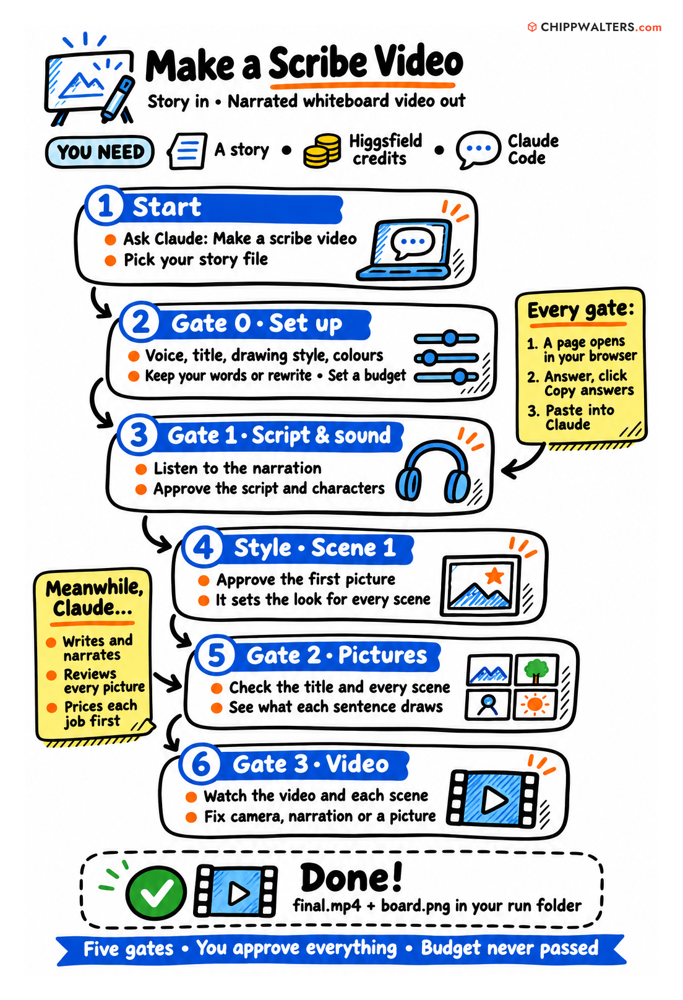
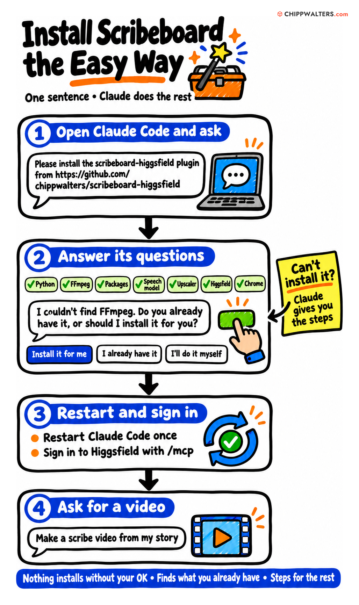

# Scribeboard with Higgsfield

**Turn a story into a narrated whiteboard video, inside Claude Code.**

You give Claude a short story. Claude writes the script, Higgsfield draws the pictures and speaks the narration, and your computer draws them onto a whiteboard, one stroke at a time, in time with the voice. You approve the work at five points along the way, and nothing that costs credits happens before you say so.

Version 0.4.1 · Windows · [Full guide](docs/GUIDE.md) · [Changelog](CHANGELOG.md) · [GPL-3.0 license](LICENSE)

**[Watch the 8-minute tutorial](TUTORIAL-VIDEO-URL)**: one story, from file to finished video, with every gate on screen.



## Install

Open Claude Code and ask:

> Please install the scribeboard-higgsfield plugin from https://github.com/chippwalters/scribeboard-higgsfield

That's the whole install. Claude installs the plugin, then checks what your computer needs and asks before installing anything:

> **I couldn't find FFmpeg. Do you already have it, or should I install it for you?**

Anything Claude can't do, it explains step by step. At the end you restart Claude Code once and sign in to Higgsfield with `/mcp`.



Prefer to do it yourself? See [Install by hand](docs/GUIDE.md#appendix-install-by-hand).

## What you need

- **Windows 10 or 11** with winget (built in on current Windows).
- **[Claude Code](https://claude.com/claude-code)**.
- **A paid Higgsfield plan** with access to the Higgsfield MCP server. The pictures and the narration are made there.
- **About 3 GB of disk space** for Python, FFmpeg, the Python packages (about 700 MB), the speech-check model (1.5 GB) and the picture upscaler.
- **A graphics card with Vulkan** (almost any from the last ten years) for the picture upscaler.

The setup checks all of this, finds what you already have and installs the rest only with your OK.

## Make a video

Ask Claude:

> Make a scribe video from my story

Then pick your story file: a text or Markdown file, a paragraph or a few. Claude walks you through five approval pages in your browser:

| Gate | You decide |
|---|---|
| **Gate 0: set up** | keep your words or let the writer rewrite them; the narrator's voice; the title; the image model, drawing style and colours; any characters; your credit budget |
| **Gate 1: script and sound** | listen to the narration, approve the script and any character sheets, set the final budget |
| **Style: scene 1** | approve the first picture, which sets the look of all the others |
| **Gate 2: pictures** | check the title card, every scene, and the part of each picture drawn during each sentence; approve or ask for changes |
| **Gate 3: video** | watch the video and each scene; approve, or fix the camera, the narration or a picture |

The finished `final.mp4` and `board.png` land in your story's folder. The [guide](docs/GUIDE.md#make-a-video) has every step.

## What it costs

You pay Higgsfield in credits; the plugin itself is free to use. Measured prices:

- **A picture:** about 3 credits (Nano Banana 2.1 at 4K) or 4.25 (GPT Image 2.5 at 4K, high quality).
- **A narrated sentence:** about 0.5 credits.

Test videos of 36 to 44 seconds, with three or four scenes, a title card and six sentences, cost 18.5 to 24.3 credits, retries included.

**Your credits are guarded.** Every job is priced before it is paid for and booked against the budget you set; no job starts if it would take you past it. The plugin's hooks refuse any Higgsfield picture or audio call that its scripts did not book while a video is being made, and a job interrupted halfway is checked, never paid for twice.

## What leaves your computer

- **To Higgsfield:** the picture prompts (written from your story), the narration text, and any character photos you choose to upload (the setup page asks you to confirm you have the person's consent).
- **To Anthropic:** your conversation with Claude, as with any Claude Code session.
- **Stays on your computer:** your story file, the drawing animation, the speech check, the board and the video.

## Update

Ask Claude *"Update the scribeboard-higgsfield plugin"*, or run:

```powershell
claude plugin marketplace update scribeboard-higgsfield
claude plugin update scribeboard-higgsfield
```

Then restart Claude Code. Your settings and installed tools stay as they are.

## Troubleshooting

- **Check the setup any time:** run `/scribeboard-higgsfield:setup` or ask Claude to "check the scribeboard setup". It shows what is ready and installs nothing without asking.
- **`python` opens the Microsoft Store:** that's Windows' placeholder, not Python. The setup installs a real Python 3.12 (or uses yours) and puts it first on your PATH; restart Claude Code afterwards.
- **Claude can't see the Higgsfield tools:** restart Claude Code, run `/mcp`, pick **higgsfield** and sign in.
- **Copy answers didn't reach the clipboard:** some browsers block it. The page then selects the answers for you; press Ctrl+C and paste them into Claude Code.
- **A sentence or picture was made twice:** that's the plugin's own checks redoing work that failed (a narration take that stopped mid-word, a picture its reviewer rejected). Retries count against your budget like any other job.
- **"denied" on a Higgsfield call:** that's the credit guard refusing a call no script booked. Ask Claude what the next step of the video is; it continues from where it stopped.

## Uninstall

```powershell
claude plugin uninstall scribeboard-higgsfield
claude plugin marketplace remove scribeboard-higgsfield
```

To remove what the setup installed as well, delete `%LOCALAPPDATA%\scribe-higgsfield` (settings, the private Python environment and the upscaler) and `%USERPROFILE%\.cache\huggingface\hub\models--Systran--faster-whisper-medium` (the speech model). Python and FFmpeg, if the setup installed them, uninstall from Windows Settings > Apps.

## Instructions for Claude

When a user asks you to install this plugin:

1. Install it (the user approves the command):

   ```
   claude plugin install scribeboard-higgsfield --marketplace chippwalters/scribeboard-higgsfield
   ```

2. Find where it went: `claude plugin list --json` lists `scribeboard-higgsfield@scribeboard-higgsfield` with its `installPath`.
3. Read `<installPath>/skills/setup/SKILL.md` and follow it now, in this session, reading `${CLAUDE_PLUGIN_ROOT}` as `<installPath>`. It checks Python, FFmpeg, the packages, the speech model, the upscaler, the Higgsfield connection and Chrome; asks the user about each missing one; installs only what the user approves; and gives manual steps for the rest.
4. Finish with its last step: the user restarts Claude Code (that loads the plugin, the PATH changes and the Higgsfield server), signs in with `/mcp`, and then asks for a scribe video.

If `claude plugin install` fails, show the error and give the user the command above to run in a terminal.

## License

Copyright © 2026 Chipp Walters. Licensed under the [GNU General Public License v3.0 or later](LICENSE): you may use, share and change it, and anything you distribute that is built on it must be shared under the same license.

The setup downloads other people's software, each under its own license: Python, FFmpeg, the Python packages in `requirements.txt`, the faster-whisper speech model and Real-ESRGAN.
