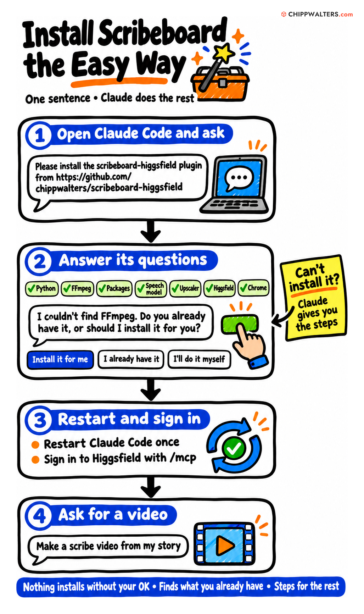
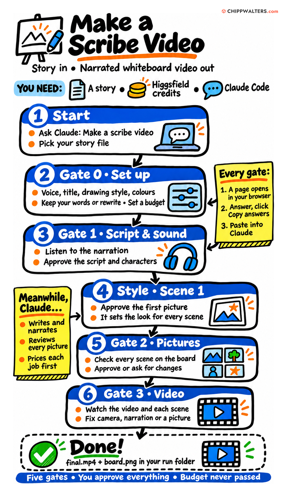
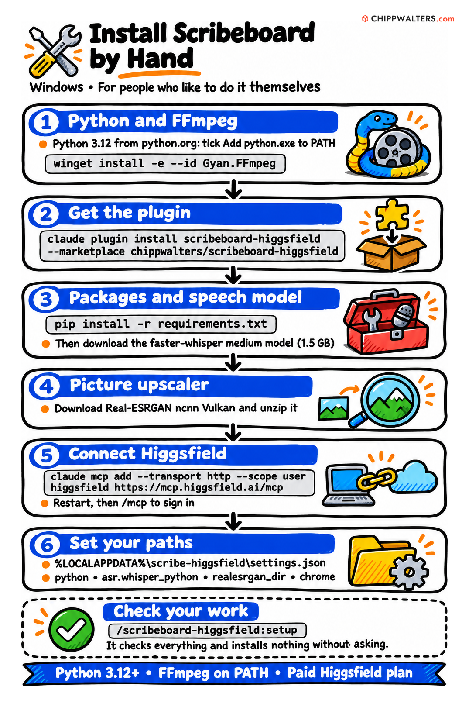

# Scribeboard with Higgsfield

The scribeboard-higgsfield plugin turns a story into a narrated whiteboard video inside Claude Code. Claude writes the script, Higgsfield draws the pictures and speaks the narration, and your computer builds the drawing animation and the video. You approve the work at five points, called gates.

This guide has three parts:

1. **Install:** one sentence to Claude; it does the rest and asks before installing anything.
2. **Make a video:** the steps from story to finished video.
3. **Appendix:** the same install done by hand, for people who prefer that.

## Install



You need Claude Code on Windows and a paid Higgsfield plan.

### 1. Ask Claude

Open Claude Code and ask:

> Please install the scribeboard-higgsfield plugin from https://github.com/chippwalters/scribeboard-higgsfield

That's the whole install. Claude installs the plugin, then checks what your computer needs.

### 2. Answer its questions

Claude checks seven things and shows you a table of what is ready and what is missing. Anything you already have, it uses and leaves alone.

| What | What it is for | If it is missing, Claude offers to |
|---|---|---|
| Python 3.12 | runs the plugin's scripts and its credit guard | install it with winget, for your user only (about 30 MB) |
| FFmpeg | cuts the narration and builds the video | install it with winget (about 100 MB) |
| Python packages | draws the animation and checks the narration | install them into a private environment (about 700 MB) that leaves your own Python alone, or into your Python |
| Speech-check model | checks every narrated sentence says exactly its words | download faster-whisper "medium" (1.5 GB, once) |
| Picture upscaler | enlarges a picture that comes back small | download Real-ESRGAN (45 MB, checked against a pinned hash) |
| Higgsfield | makes every picture and narration take | add the Higgsfield MCP server to Claude Code |
| Google Chrome (optional) | opens the approval pages | use it, or keep your default browser |

Each missing item gets one question. It says what will be installed, how big it is and what changes on your computer. For example:

> **I couldn't find FFmpeg (no `ffmpeg` on PATH). Do you already have it, or should I install it for you?**
> - **Install it for me (Recommended):** I'll run winget to install the full FFmpeg build (about 100 MB) and put ffmpeg and ffprobe on your PATH. Claude Code must restart afterwards.
> - **I already have it:** tell me where ffmpeg.exe is. I'll check that it works and add that folder to your PATH.
> - **I'll do it myself:** I'll give you the steps.

Nothing is installed until you say yes; the plugin's install script refuses to run without your answer. Anything Claude cannot do, or that you'd rather do yourself, comes back to you as numbered steps. The appendix has them all.

### 3. Restart and sign in

1. **Restart Claude Code** (quit and start it again). This loads the plugin and anything added to your PATH.
2. **Sign in to Higgsfield:** run `/mcp`, pick **higgsfield** and sign in.

To check the setup again at any time, run `/scribeboard-higgsfield:setup` or ask Claude to "check the scribeboard setup". It installs nothing without asking.

Your settings go in `%LOCALAPPDATA%\scribe-higgsfield\settings.json`. Plugin updates leave that file alone.

## Make a video



### What you need

- **A story.** A text or Markdown file. Short is fine: a 70-word story makes a video of about 40 seconds.
- **Higgsfield credits.** Each picture and each spoken sentence costs credits. A test run with three scenes, a title card and six sentences cost 21.1 credits.

### How every gate works

1. A page opens in your browser.
2. Answer its questions, then click **Copy answers**. The button refuses while a required question is blank.
3. Paste the answers into Claude Code.

Claude records your answers and moves on. Nothing that costs credits happens before the page that allows it.

### 1. Start

Ask Claude *"Make a scribe video from my story"* (or run `/scribeboard-higgsfield:scribe-higgsfield`) and pick your story file. Claude checks your setup and your Higgsfield sign-in first; if anything is missing it runs the setup wizard. Every file of the video goes into the story's own folder. A writer reads the story and lists its characters.

### 2. Gate 0: set up

Choose:

- whether to keep your words or let the writer rewrite them
- the narrator's voice
- the video's title
- the image model and the drawing style
- the colours
- each character: an optional character sheet, from a description or from photos
- your credit budget

### 3. Gate 1: script and sound

Claude records the narration in the voice you chose and makes any character sheets. The page plays the narration and shows each sheet in your colours. Approve the script and the sheets, or say what to change, and set the final budget.

### 4. Style: scene 1

Higgsfield draws the first scene alone. Approve it, or say what to change. This picture sets the look for every other scene and for the title card.

### 5. Gate 2: pictures

Higgsfield draws the remaining scenes and the title card. A separate reviewer checks each picture against the script before you see it. The page shows every scene on the board. Approve them, or ask for changes to any one.

### 6. Gate 3: video

Claude builds the video. The page shows the full video, the board and one clip for each scene. Each clip is cut on the narration, so every sentence plays whole. Approve the video, or edit a scene. An edit names what to fix:

- **Camera:** the moves and framing
- **Narration:** a sentence's words or how a word is said
- **Picture:** what a scene shows

Each kind of edit goes to its own fix. If a sentence was recorded again after Gate 1, the page says so.

### Done

The finished files are in the story's folder:

- `videos/final.mp4`: the video
- `videos/board.png`: every scene on one board
- `credits.json`: every paid job and what it cost

## Credits

- Before each paid job, the plugin asks Higgsfield for its exact price.
- It books that price in the run's `credits.json` before the job goes out.
- No job starts if it would take the run past your budget.
- The plugin's hooks refuse any Higgsfield generate call that no script booked while a run is under way.
- If a session stops in the middle of a job, the plugin tells Claude to check that job, never to pay for it twice.

## Updating

Ask Claude *"Update the scribeboard-higgsfield plugin"*, or run:

```powershell
claude plugin marketplace update scribeboard-higgsfield
```

```powershell
claude plugin update scribeboard-higgsfield
```

The first command fetches the latest version from GitHub; the second installs it. Restart Claude Code afterwards. Your settings and installed tools stay as they are.

## What the plugin adds to every session

- **The skills' names and one-line descriptions.** The full instructions load only when you run a skill.
- **Two hooks.** They run only when a session calls a Higgsfield `generate_image` or `generate_audio` tool, and they block only unbooked paid calls while a scribe run is under way.

## Appendix: install by hand



The same setup, step by step, for people who prefer to install things themselves. The commands are for PowerShell on Windows.

### 1. Python 3.12

Download Python 3.12 from [python.org](https://www.python.org/downloads/) and tick **Add python.exe to PATH** in the installer. Or use winget with the switch that adds Python to your PATH:

```powershell
winget install --exact --id Python.Python.3.12 --scope user --override "/quiet InstallAllUsers=0 PrependPath=1 Include_launcher=1"
```

Open a new terminal and check that `python --version` prints 3.12 or later. The plugin's hooks call `python`, so it must be on your PATH.

### 2. FFmpeg

```powershell
winget install --exact --id Gyan.FFmpeg
```

Open a new terminal and check that `ffmpeg -version` and `ffprobe -version` both run.

### 3. The plugin

```powershell
claude plugin install scribeboard-higgsfield --marketplace chippwalters/scribeboard-higgsfield
```

### 4. Python packages and the speech model

A private environment keeps the plugin's packages apart from your own Python:

```powershell
$plugin = (Get-ChildItem "$env:USERPROFILE\.claude\plugins\cache\scribeboard-higgsfield\scribeboard-higgsfield" | Sort-Object Name | Select-Object -Last 1).FullName
python -m venv "$env:LOCALAPPDATA\scribe-higgsfield\env"
& "$env:LOCALAPPDATA\scribe-higgsfield\env\Scripts\python.exe" -m pip install --only-binary :all: -r "$plugin\requirements.txt"
```

Then download the speech-check model (1.5 GB, once):

```powershell
& "$env:LOCALAPPDATA\scribe-higgsfield\env\Scripts\python.exe" -c "from faster_whisper.utils import download_model; print(download_model('medium'))"
```

### 5. Picture upscaler

Download [realesrgan-ncnn-vulkan-20220424-windows.zip](https://github.com/xinntao/Real-ESRGAN/releases/download/v0.2.5.0/realesrgan-ncnn-vulkan-20220424-windows.zip) from the Real-ESRGAN releases page and unzip it to `%LOCALAPPDATA%\scribe-higgsfield\realesrgan`.

### 6. Connect Higgsfield

```powershell
claude mcp add --transport http --scope user higgsfield https://mcp.higgsfield.ai/mcp
```

Restart Claude Code, run `/mcp`, pick **higgsfield** and sign in. The Higgsfield connector in the Claude app on its own is not enough: the plugin needs this server in Claude Code.

### 7. Set your paths

Create `%LOCALAPPDATA%\scribe-higgsfield\settings.json` (replace `<you>` with your Windows user name):

```json
{
  "python": "C:/Users/<you>/AppData/Local/scribe-higgsfield/env/Scripts/python.exe",
  "asr": { "whisper_python": "C:/Users/<you>/AppData/Local/scribe-higgsfield/env/Scripts/python.exe" },
  "realesrgan_dir": "C:/Users/<you>/AppData/Local/scribe-higgsfield/realesrgan",
  "chrome": "C:/Program Files/Google/Chrome/Application/chrome.exe",
  "runs_home": "C:/Users/<you>/Videos/Scribeboard"
}
```

- `python`: the Python that runs the plugin's scripts.
- `asr.whisper_python`: the Python that has faster-whisper.
- `realesrgan_dir`: the folder holding `realesrgan-ncnn-vulkan.exe`.
- `chrome` (optional): where the approval pages open; leave it out to use your default browser.
- `runs_home` (optional): where the story picker opens.

### 8. Check your work

```text
/scribeboard-higgsfield:setup
```

The wizard checks all seven items and shows what is ready. It installs nothing without asking, so it is safe to run after a manual install.
